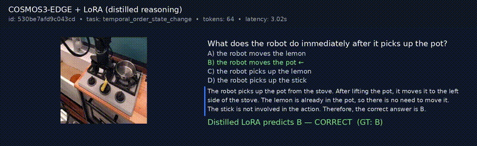
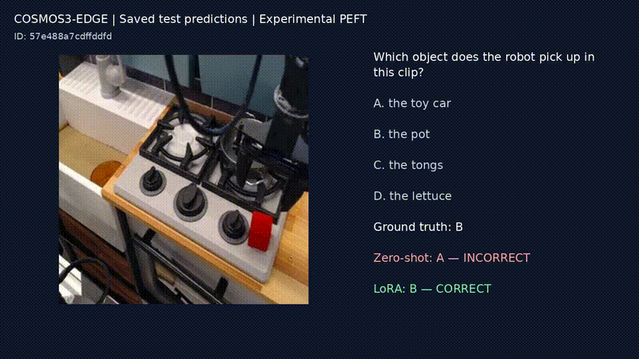

---
language:
  - en
task_categories:
  - video-question-answering
  - video-text-to-text
task_ids:
  - multiple-choice-qa
pretty_name: "Cosmos 3 Temporal MCQ (BridgeData2, Human-Verified)"
size_categories:
  - n<1K
tags:
  - robotics
  - temporal-reasoning
  - video
  - multiple-choice
  - cosmos
configs:
  - config_name: default
    data_files:
      - split: train
        path: data/train.jsonl
      - split: validation
        path: data/validation.jsonl
      - split: test
        path: data/test.jsonl
---

# Cosmos 3 Temporal MCQ

**Cosmos 3 Temporal MCQ** is a human-reviewed multiple-choice video question-answering dataset for **temporal reasoning in robot manipulation**. It is derived from the NVIDIA BridgeData2 synthetic-caption dataset and was prepared for video-reasoning experiments, including LoRA fine-tuning and evaluation with NVIDIA Cosmos 3.

Each example contains a question about a short robot-manipulation clip, four answer options labeled `A`–`D`, and one correct answer. The questions cover three categories:

- **Action/object understanding:** identifying actions, objects, and their interactions.
- **Temporal order and state change:** reasoning about event sequences and changes over time.
- **Observed outcome:** identifying the outcome of an observed action.

The released dataset contains only reviewed annotations and source-video references, not the video files themselves.

## Dataset Summary

| Property | Value |
|---|---|
| Verified examples | **644** |
| Train / validation / test | 523 / 57 / 64 |
| Distinct source videos | **476** |
| Source videos by split | 383 / 44 / 49 |
| Excluded candidates | 408 (353 ambiguous, 55 incorrect) |
| Answer format | One letter: `A`, `B`, `C`, or `D` |
| Source dataset | `nvidia/BridgeData2-Subset-Synthetic-Captions` |
| Pinned source revision | `e841d88db9f36caa4c805c31509712676c0fda0e` |
| Bundle version | `v0.2.0-cosmos3-lora` |
| Media mode | `reference` — video bytes are not included |
| Dataset fingerprint | `fece449f0d04c00b976fa2f58cd15fc8d436d1506ce8a902097544432285f57e` |

The train, validation, and test splits inherit a **source-video-level split**, preventing clips from the same source video from appearing across different splits. The test split is frozen for reproducible comparisons.

## Quick Start

The published bundle includes annotations and source-video mappings, but **does not include the 476 source videos**. Download and bind the required videos from the pinned upstream revision before preparing training data.

### 1. Download the dataset

Install the Hugging Face Hub CLI if needed:

```bash
pip install -U huggingface_hub
```

Download a specific dataset revision for reproducibility:

```bash
hf download p4wndev/cosmos3-temporal-mcq \
  --repo-type dataset \
  --revision e4c2cb935f97162e38c70616066934d987d503df \
  --local-dir ./datasets/cosmos3-temporal-mcq
```

Omit `--revision` to download the latest version instead. For reproducible experiments, use a pinned revision.

### 2. Download and bind the source videos

```bash
python ./datasets/cosmos3-temporal-mcq/scripts/download_videos.py \
  --root ./datasets/cosmos3-temporal-mcq
```

The script resolves each required clip through the authoritative `source_video_id` → upstream `uuid` mapping and validates file size and SHA-256 checksums.

### 3. Verify the dataset

```bash
python ./datasets/cosmos3-temporal-mcq/scripts/verify_dataset.py \
  --root ./datasets/cosmos3-temporal-mcq \
  --require-videos
```

### 4. Prepare Cosmos-RL training inputs

```bash
python ./datasets/cosmos3-temporal-mcq/scripts/prepare_training_data.py \
  --root ./datasets/cosmos3-temporal-mcq \
  --output ./datasets/cosmos3-temporal-mcq-prepared
```

The preparation script generates per-split `annotations.json` files using the TAO `tao-vl-reason-v1.0` schema, with `task: mcq`, along with a media-root mapping. It prints the corresponding `--train_annotations` and `--media_roots` arguments and defaults to the `train` and `validation` splits.

The three scripts use the Python standard library and can run without a repository checkout. Run them from any working directory and pass the dataset bundle location through `--root`.

Useful options for `download_videos.py`:

- `--verify-only`: verify an already-bound video tree.
- `--upstream-dir <path>`: bind videos from a local upstream copy.

Video downloads require network access and access to the upstream Hugging Face dataset. Downloads are cached and resumable, and repeated runs are designed to be idempotent.

Approximate storage requirements:

- Annotation bundle: **1.4 MB**
- Required source videos: **230 MB**
- Full reproduction workspace: approximately **0.7 GB**

## Model Experiments

Cosmos 3 experiments were conducted using this dataset to compare zero-shot inference with LoRA fine-tuning. The following results use the frozen **64-example test split**.

| Method | Accuracy | Correct | Mean generated tokens | Mean latency per example |
|---|---:|---:|---:|---:|
| Cosmos 3 Edge, zero-shot | 43.75% | 28/64 | 320.55 | 10.81 s |
| Cosmos 3 Edge, answer-only LoRA | **90.63%** | **58/64** | 4.00 | 0.44 s |
| Cosmos 3 Edge, reasoning-distilled LoRA | 68.75% | 44/64 | 216.58 | 9.66 s |

The answer-only LoRA adapter achieved the highest accuracy among these three configurations. It also produced shorter outputs and lower measured latency because it was trained to return the answer letter directly. The reasoning-distilled adapter retained a longer response format but achieved lower accuracy on this test set.

In a paired comparison, the answer-only LoRA corrected 30 examples that zero-shot inference answered incorrectly, with no regressions among the examples answered correctly by zero-shot inference.

## Demo

### Reasoning-distilled adapter



### Answer-only adapter



**How to interpret these results**

- These are results from a small test set of 64 examples; they should be treated as preliminary rather than conclusive evidence of generalization.
- Latency and throughput depend on the hardware, inference configuration, and runtime environment. The reported latency is specific to the experiment and should not be generalized to other deployments.
- Answer-only and reasoning-distilled LoRA use different output targets, so their accuracy and generation lengths reflect different training objectives.
- The results do not establish performance on other robotics datasets, unseen task distributions, or real-world deployment scenarios.
- The reported benchmark does not, by itself, demonstrate that every generated answer is supported by detailed visual evidence.

These experiments provide an initial benchmark for this dataset. Broader evaluation across more videos, task types, and model configurations is needed to assess generalization.

## Human Review and Quality Control

All **1,052 candidate questions** were reviewed against their source videos by the dataset owner. The review process recorded answer confirmations, corrections, and exclusion decisions.

| Review outcome | Count | Released? |
|---|---:|---|
| Verified | 644 | Yes |
| Incorrect | 55 | No |
| Ambiguous | 353 | No |
| **Total reviewed** | **1,052** | |

Of the 57 recorded answer corrections, 55 belong to questions classified as `incorrect` and excluded from the release. The remaining two belong to `verified` questions and are reflected in the released annotations.

Review is complete, and the released records are structurally consistent and reproducible. However, the stored review records do not independently reconstruct detailed visual evidence for every decision: there are no per-decision notes, and some recorded timing arithmetic does not reconcile with full clip playback. This is a limitation of the audit record, not a finding that individual review decisions are necessarily wrong.

For the review criteria, process, and audit limitations, see:

- [`docs/human_review.md`](docs/human_review.md)
- [`reports/review_audit.md`](reports/review_audit.md)

## Validation Status

**Validated**

- Structural integrity, including unique identifiers, four distinct answer options, and valid answer letters.
- Split integrity, including source-video-level separation between train, validation, and test.
- Compatibility with the TAO `tao-vl-reason-v1.0` annotation schema for task-aware MCQ examples with `answer_type: letter`.
- Acceptance by the packaged Cosmos-RL dataset inspector.
- Human review of the released questions against their source videos.

**Evaluated**

- Zero-shot and LoRA configurations were benchmarked on the frozen 64-example test split.
- Accuracy, output length, and inference latency were recorded for the tested configurations.

**Not established**

- Generalization beyond the released test set.
- Performance across other robotics tasks, datasets, or deployment environments.
- Independent reconstruction of detailed visual evidence for every human-review decision.
- Broad Cosmos 3 compatibility beyond the model configuration and workflow used in the reported experiments.

Schema validation is not a guarantee of compatibility with every Cosmos 3 training configuration. Likewise, a successful benchmark on this dataset does not establish general-purpose video reasoning capability.

## Repository Contents

This repository is the source-of-truth project for dataset generation, validation, review tooling, and release preparation. Raw videos, full annotations, individual review decisions, and generated release bundles are excluded from version control.

| Path | Contents |
|---|---|
| `DATASET_CARD.md` | Dataset structure, methodology, fields, and licensing notes |
| `docs/human_review.md` | Human-review criteria, process, and limitations |
| `docs/dataset_provenance.md` | Upstream source, mapping, lineage, and fingerprints |
| `docs/annotation_guidelines.md` | Question construction and acceptance rules |
| `docs/evaluation_protocol.md` | Evaluation protocol for zero-shot and LoRA experiments |
| `docs/limitations.md` | Known limitations |
| `src/temporal_mcq/`, `scripts/`, `tests/` | Implementation, scripts, and CPU-only tests |
| `reports/` | Aggregate audit reports without per-question data |

To reproduce the dataset from source, with network access and approximately 0.7 GB of workspace storage:

```bash
make download
make generate
make build
make validate

make materialize
make build-training-bundle
```

The final command builds the `dist/v0.2.0-cosmos3-lora` bundle.

## Limitations

- **Caption-grounded questions:** the questions and candidate answers are derived from synthetic captions. Human review checked answers against the source videos, but did not establish the full accuracy of every caption.
- **Small dataset:** 644 verified examples are available, with only 57 validation and 64 test examples.
- **Limited question diversity:** the dataset uses three fixed question categories and a limited set of question templates.
- **Reference-only media:** source videos are not included in the published bundle and must be obtained from the upstream dataset.
- **Unresolved redistribution rights:** the rights to redistribute derived annotations, source videos, and this code have not been fully established.
- **Limited audit traceability:** the stored review records do not contain detailed visual evidence for every individual decision.

See [`docs/dataset_provenance.md`](docs/dataset_provenance.md) and [`docs/limitations.md`](docs/limitations.md) for further details.

## Citation and License

If you use this dataset, please cite the upstream BridgeData V2 paper:

> Walke, H., et al. "BridgeData V2: A Dataset for Robot Learning at Scale." *Conference on Robot Learning (CoRL)*, 2023. [arXiv:2308.12952](https://arxiv.org/abs/2308.12952)

The upstream source is [`nvidia/BridgeData2-Subset-Synthetic-Captions`](https://huggingface.co/datasets/nvidia/BridgeData2-Subset-Synthetic-Captions), pinned to revision `e841d88db9f36caa4c805c31509712676c0fda0e`, with the declared license `LicenseRef-OpenMDW-1.1`.

**Redistribution rights for the derived annotations, source videos, and this code have not yet been established. No license is granted by this repository.** Do not assume that the dataset or its derivatives can be redistributed or used without additional permission. See [`LICENSE`](LICENSE) and [`docs/dataset_provenance.md`](docs/dataset_provenance.md) for the current licensing notes.

## Links

- **Dataset:** [p4wndev/cosmos3-temporal-mcq](https://huggingface.co/datasets/p4wndev/cosmos3-temporal-mcq)
- **Upstream source dataset:** [nvidia/BridgeData2-Subset-Synthetic-Captions](https://huggingface.co/datasets/nvidia/BridgeData2-Subset-Synthetic-Captions)
- **BridgeData V2 project:** [rail-berkeley.github.io/bridgedata](https://rail-berkeley.github.io/bridgedata/)
